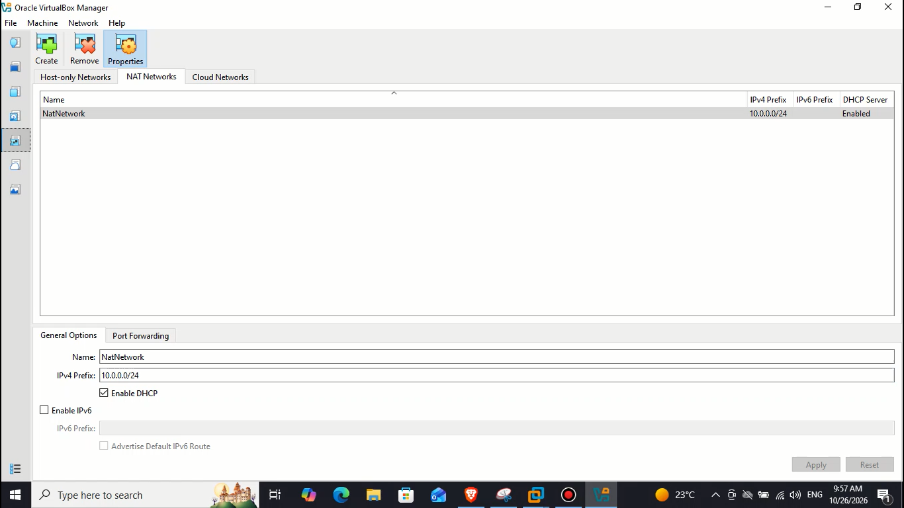

# NETWORKWALKS-B084-WK1-PM1-CYBERSECURITY-HOME-LAB

Hands-on cybersecurity home lab setup using virtualization. Documenting my lab configuration, network setup, testing, screenshots, and troubleshooting while learning from the NETWORKWALKS lab guide.

<div align="center">

# 🔐 Cybersecurity Lab Environment Setup

**Building a controlled virtual lab for penetration testing and ethical hacking practice.**

</div>

<p align="center">
  
  
  
  
  
  
  
</p>

---

## 📌 Project Overview

This project focuses on setting up a **virtual cybersecurity and penetration-testing laboratory** using Oracle VirtualBox and Kali Linux.

The purpose of the lab is to build a controlled environment for learning virtualization, network configuration, Linux administration, network reconnaissance, vulnerability assessment, packet analysis, and other cybersecurity concepts.

The lab uses a VirtualBox NAT Network to enable communication between connected virtual machines and provide outbound network connectivity. Additional virtual machines can be added in future projects for authorized security testing.

## 🎯 Objectives

The main objectives of this project are to:

- Install and configure Oracle VirtualBox.
- Extract and import Kali Linux into VirtualBox.
- Create a dedicated NAT Network for the cybersecurity lab.
- Configure and verify Kali Linux network connectivity.
- Configure a consistent IP address for the Kali Linux VM.
- Verify IP addressing, routing, and DNS resolution.
- Create a clean virtual machine snapshot for recovery.
- Document the setup process, screenshots, and troubleshooting.
- Prepare the environment for future cybersecurity projects.

## 🛡️ Purpose of the Lab

This lab is intended for cybersecurity education and authorized security testing.

Potential learning activities include:

- Network reconnaissance
- Port scanning
- Vulnerability assessment
- Packet analysis
- Web application security testing
- Exploitation practice in authorized lab environments
- Cybersecurity tool experimentation

> ⚠️ **Ethical use:** Only test systems that you own or have explicit permission to assess. A NAT Network does not guarantee complete isolation from the host or external networks. Verify network boundaries before conducting security tests.

---

## 🏗️ Lab Architecture

```text
                 HOST COMPUTER
                       |
                Oracle VirtualBox
                       |
              VirtualBox NAT Network
                  10.0.0.0/24
                       |
                 +-----+-----+
                 |           |
             Kali Linux   Future Lab VM
             10.0.0.2*     10.0.0.x*
                 |           |
                 +-----+-----+
                       |
            VM-to-VM Communication
             and Outbound NAT Access
```

`*` Example addresses; verify the actual configuration.

Additional authorized target machines can be connected to the same NAT Network in future projects.

---

## ⚙️ Lab Configuration

| Component | Configuration |
|---|---|
| Host Operating System | Windows 10 |
| Host RAM | 6 GB |
| Processor | Intel Core i3 |
| Hypervisor | Oracle VirtualBox 7.2 |
| Security Operating System | Kali Linux 2026.2 |
| Kali Linux RAM | 2048 MB |
| Virtual Network | NAT Network |
| Network Name | NatNetwork |
| Network Prefix | 10.0.0.0/24 |
| Kali Linux IP | 10.0.0.2/24 |
| Default Gateway | 10.0.0.1 |
| DNS Server | 8.8.8.8 |
| Future VM Address Range | 10.0.0.3–10.0.0.99 |

**Note:** The versions and network values above reflect the intended lab configuration. Verify them against the installed software and actual VirtualBox network settings. Confirm that the static IP address, gateway, DHCP pool, and future VM range do not conflict.

---

# 🪜 Lab Setup Procedure

## Step 1: Install 7-Zip

7-Zip was installed to extract the Kali Linux virtual machine package distributed as a compressed archive.

**Tool:** 7-Zip

Download: [Official 7-Zip website](https://www.7-zip.org/download.html)

---

## Step 2: Install VirtualBox

Oracle VirtualBox was installed as the hypervisor for creating and managing virtual machines.

Download: [Official VirtualBox Downloads](https://www.virtualbox.org/wiki/Downloads)

---

## Step 3: Create the NAT Network

A dedicated NAT Network was created in VirtualBox for the cybersecurity lab.

**Network configuration**

```text
Network Name: NatNetwork
IPv4 Prefix:  10.0.0.0/24
DHCP:         Enabled
IPv6:         Disabled
```



A **NAT Network** allows multiple virtual machines connected to the same network to communicate with one another while providing network address translation for outbound connectivity.

This configuration provides a foundation for a multi-machine lab environment.

---

## Step 4: Import Kali Linux

Kali Linux was downloaded from the official Kali Linux website and imported into VirtualBox.

Download: [Official Kali Linux Downloads](https://www.kali.org/get-kali/)

The virtual machine network adapter was configured as follows:

```text
Adapter:      Adapter 1
Attached to:  NAT Network
Network:      NatNetwork
Adapter Type: Intel PRO/1000 MT Desktop
```

The virtual machine was allocated the following memory:

```text
RAM: 2048 MB
```


A shared folder was also configured to transfer required files between the host operating system and the Kali Linux VM.

---

## Step 5: Configure the Kali Linux Network

The Kali Linux network configuration was checked and configured to use a consistent IPv4 address.

**Intended network configuration**

```text
IP Address:   10.0.0.2
Subnet Mask:  255.255.255.0
Gateway:      10.0.0.1
DNS Server:   8.8.8.8
```


A consistent IP address makes it easier to document the lab and reference the Kali Linux machine during future exercises.

**Important:** Because DHCP is enabled on the NAT Network, confirm that `10.0.0.2` is available and does not conflict with another address. If necessary, configure a DHCP reservation or use an appropriate static configuration.

---

## Step 6: Verify Network Connectivity

After configuring the network, verify the IP address, default route, gateway connectivity, DNS resolution, and outbound connectivity.

### 6.1 Check the IP address

```bash
ip -br addr
```

This command displays the network interfaces and their assigned IP addresses.

### 6.2 Check the default gateway

```bash
ip route
```

This command displays the routing table and default route.

### 6.3 Test gateway connectivity

Replace `<gateway-ip>` with the actual gateway address.

```bash
ping -c 4 <gateway-ip>
```

### 6.4 Test DNS resolution

```bash
getent hosts kali.org
```

This checks whether the system can resolve the hostname.

### 6.5 Check outbound connectivity

```bash
ping -c 4 8.8.8.8
```

A successful response indicates that ICMP connectivity to that destination is available. Failure alone does not prove that internet access is unavailable, since ICMP may be filtered.


Record the actual test results and any troubleshooting performed. Do not mark a test as successful unless you have verified it.

### 6.6 Create a VirtualBox Snapshot

After verifying the initial configuration, create a snapshot of the virtual machine using VirtualBox's Snapshot Manager.

A clean snapshot provides a known recovery point before making significant changes or conducting authorized security experiments.

---

# 💡 What I Learned

Through this project, I developed practical knowledge of virtual machine deployment, network configuration, and cybersecurity lab preparation.

### 1. NAT vs. NAT Network

A standard VirtualBox NAT configuration and a NAT Network have different networking behaviors.

A NAT Network allows connected VMs to communicate with each other while supporting outbound network connectivity through NAT.

### 2. Virtual Machine Networking

I learned how virtual network adapters connect virtual machines to different network types and how adapter settings affect communication.

### 3. IPv4 Configuration

I learned about IP addresses, subnet masks, default gateways, DNS servers, and the importance of avoiding address conflicts.

### 4. Network Verification

I learned how to use Linux networking commands to inspect IP configuration, routing, gateway connectivity, and DNS resolution.

### 5. Virtual Machine Snapshots

I learned the importance of creating a known-good snapshot before making significant changes to a virtual machine.

### 6. Technical Documentation

I learned how to document configurations, screenshots, verification steps, troubleshooting, and lessons learned in a GitHub repository.

---

# 🔐 Security and Ethical Use

This laboratory is intended for educational purposes and authorized security testing.

- Test only systems that you own or have explicit permission to assess.
- Use controlled lab targets for vulnerability assessment and exploitation practice.
- Verify network boundaries before running security tools.
- Keep backups or snapshots before making significant system changes.
- Document findings and remediation steps responsibly.

---

# 🔗 Tools and Resources

- **7-Zip:** [Download](https://www.7-zip.org/download.html)
- **Oracle VirtualBox:** [Downloads](https://www.virtualbox.org/wiki/Downloads)
- **Kali Linux:** [Official Downloads](https://www.kali.org/get-kali/)

---

# 👤 Author

**Bigyan Tamang**

Cybersecurity Learner | Network and System Administration

LinkedIn: [Bigyan Tamang](https://www.linkedin.com/in/bigyan-tamang-776613200/)

---

## 📌 Project Information

- **Program:** Cybersecurity at NetworkWalks
- **Batch:** B084
- **Week:** 01
- **Project:** Cybersecurity and Penetration-Testing Lab Setup
- **Repository:** GitHub

---

*This repository documents my hands-on learning journey in cybersecurity, virtualization, network configuration, and ethical security testing.*
